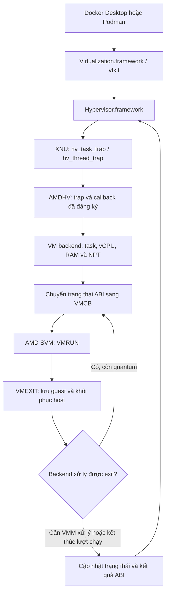

# FixVM / AMDHV

AMDHV là kernel extension cung cấp backend **AMD SVM** cho
**Hypervisor.framework trên macOS x86_64**, hướng tới chạy Docker Desktop và
Podman bằng backend ảo hóa native của macOS trên máy AMD Ryzen.

Linux container chạy bên trong VM Linux do Docker/Podman quản lý. AMDHV thực thi
vCPU bằng phần cứng AMD SVM và ánh xạ RAM bằng NPT; đường chạy đã kiểm chứng dùng
Apple Virtualization.framework, không phụ thuộc QEMU/TCG.

**Bản đã kiểm chứng phần cứng: 0.3.40 — dự án thử nghiệm, đã chạy được workload
thực tế; chưa được xác nhận ổn định dài hạn hoặc sleep/wake.**

**Mã nguồn hiện tại: 0.3.42.** Bản 0.3.41 (sửa treo khi sleep, IPI kick, bỏ flush
TLB mỗi lượt chạy, giảm VMEXIT) đã được nạp và chạy một VM Docker 8 vCPU trên máy
thử, nhưng chưa chạy lại bộ kiểm thử phần cứng. Bản 0.3.42 bỏ giới hạn cứng 8 GiB
RAM mỗi VM và chuyển FP/XCR0 ra khỏi từng lần VMRUN; mới qua cổng kiểm tra
offline. Bảng kết quả bên dưới thuộc về 0.3.40. Xem [Thay đổi 0.3.41](#thay-đổi-0341)
và [Thay đổi 0.3.42](#thay-đổi-0342).

## Kết quả đã kiểm chứng

| Thành phần | Cấu hình và kết quả |
| --- | --- |
| Docker Desktop | 4.99.0, engine 29.9.3, Apple Virtualization, 4 vCPU / 4 GiB; nhiều lượt container, build, network, storage và CPU stress đạt |
| Podman test | 5.8.9, provider `applehv` / vfkit, 4 vCPU / 4 GiB; lặp lại workload và kiểm tra dữ liệu sau hard restart đạt |
| Podman mặc định | `podman-machine-default`, 12 vCPU / 3814 MiB; 2 lượt workload đầy đủ, gồm stop/start, kiểm tra volume và hash trên đủ 12 CPU đạt |
| Backend | SVM self-test 24/24 CPU; VM/vCPU, chế độ tuần tự/song song, vòng đời tài nguyên và hai VM task chạy đồng thời đã qua kiểm thử |

Các lượt kiểm thử gồm DNS, published port, bind mount, volume, build image và
hash dữ liệu trên từng vCPU. Đây là kết quả trên một cấu hình máy thật, chưa phải
cam kết tương thích với mọi CPU AMD, phiên bản macOS hay cấu hình VM.

Xem [kết quả chấp nhận 0.3.40](research/NATIVE-ACCEPTANCE-0.3.40.md) và
[kiểm chứng máy Podman mặc định](research/PODMAN-DEFAULT-0.3.40.md).

## Luồng hoạt động



### 1. Nạp kext

`AMDHV::start()` kiểm tra boot-arg `-amdhvoff`, đọc thông tin SVM qua CPUID,
công bố thông tin trong IORegistry và đăng ký nhóm sysctl `debug.amdhv.*`.
Việc nạp kext chưa tự bật takeover hoặc chạy VM. Self-test SVM là thao tác riêng.

### 2. Bật backend và tiếp nhận lời gọi Hypervisor.framework

Khi bật `debug.amdhv.takeover`, resolver kiểm tra phiên bản kernel và các byte
chữ ký của những hàm XNU cần dùng. Bảng tham chiếu được tạo từ KDK và Boot Kernel
Collection tương ứng. Nếu kiểm tra không khớp, quá trình tiếp nhận bị từ chối.

Sau đó AMDHV khởi tạo backend, thay đăng ký trap/callback Hypervisor của AppleHV
bằng handler của mình và đặt biến hỗ trợ phía kernel để `kern.hv_support = 1`.
Đây là đăng ký qua cơ chế trap/callback của XNU; dự án không thay file framework
hay viết lại mã máy của AppleHV tại bước này.

`kern.hv_support = 1` cho ứng dụng biết backend khả dụng. Nó chưa chứng minh một
VM có thể boot; điều đó được kiểm tra bằng các probe và workload bên trên.

### 3. Tạo VM, vCPU và ánh xạ bộ nhớ

Hypervisor.framework gửi yêu cầu tạo VM/vCPU qua task trap và thread trap.
`vm_backend.cpp` gắn VM với task, gắn vCPU với thread sở hữu và quản lý vòng đời
các đối tượng. Các yêu cầu map/unmap/protect đi vào lớp bộ nhớ guest.

RAM guest được giữ bằng memory descriptor; NPT ánh xạ địa chỉ vật lý guest sang
trang RAM host tương ứng. Trạng thái thanh ghi, control field và MSR được chuyển
giữa ABI mà VMM của Apple sử dụng và VMCB của AMD SVM. Chỉ các chức năng đã triển
khai mới được chấp nhận; AMDHV không cung cấp toàn bộ Intel VMX API.

### 4. Chạy vCPU trên phần cứng AMD

Khi VMM gọi chạy vCPU, backend đọc trạng thái chia sẻ, chuẩn bị VMCB và chuyển
điều khiển tới `vcpu_svm.cpp` / `svm_vmrun.S`. Mỗi lượt thực thi giữ việc chuyển
host/guest trên cùng CPU vật lý cho tới khi trạng thái host được khôi phục.

Assembly lưu trạng thái host, nạp trạng thái guest và thực hiện `VMRUN`. Khi có
VMEXIT, backend thu trạng thái guest và khôi phục trạng thái host, gồm các phần
thanh ghi, FP/XSAVE và trạng thái hệ thống cần thiết cho đường chuyển này.

Backend xử lý một số exit nội bộ, như các thao tác control register/MSR được hỗ
trợ hoặc invalidation. Exit cần VMM xử lý được chuyển về định dạng ABI phù hợp.
VMM tiếp tục quản lý thiết bị ảo, I/O và vòng chạy VM; kext không tự thay thế
toàn bộ Docker, vfkit hay Virtualization.framework.

### 5. Fast mode và chạy song song

`fast=1` dùng đường chạy không gắn single-step nội bộ cho từng lệnh guest.
Host interrupt cho phép CPU trả quyền điều khiển; backend xử lý một quantum hữu
hạn các exit trước khi trả kết quả. Chế độ step vẫn phục vụ chẩn đoán.

Trong 0.3.40, `parallel=1` cho phép các thread sở hữu vCPU khác nhau chạy fast
đồng thời dưới khóa đọc. Thay đổi mapping, trạng thái và vòng đời đối tượng dùng
khóa ghi; yêu cầu ngắt vCPU có đường đồng bộ riêng. Vì vậy NPT và tài nguyên VM
không bị thay đổi giữa lúc một lượt chạy đang sử dụng chúng.

Từ 0.3.41, ở chế độ fast code64 mỗi vCPU có ASID riêng và giữ TLB của guest giữa
các lượt chạy; backend chỉ flush khi vCPU đổi CPU vật lý, NPT thay đổi, VMM đổi
thanh ghi phân trang, có CR/INVLPG được giả lập hoặc VMM yêu cầu. Guest tự xử lý
CR2/CR3/INVLPG trên phần cứng. `hv_vcpu_interrupt` gửi IPI tới đúng CPU đang chạy
vCPU đích, giống cách AppleHV dùng `mp_cpus_kick`.

### 6. Dừng VM và tắt backend

Trap destroy và callback khi task/thread kết thúc giải phóng vCPU, mapping và
tài nguyên liên quan. Backend từ chối tắt takeover khi vẫn còn VM sống.

Sau khi đã công bố callback vào XNU, kext chặn việc unload nóng. Tắt backend
bằng sysctl không đồng nghĩa với gỡ kext; thay hoặc gỡ bản kext cần cập nhật
Auxiliary Kernel Collection và reboot.

## Môi trường đã thử

- AMD Ryzen 9 9900X, Zen 5, 24 luồng, RAM 64 GiB; SVM bật trong BIOS.
- macOS 26.7.2, build `25G332`, XNU `12377.161.15.701.48~2`.
- Command Line Tools / SDK macOS 26.5 và KDK `25G332`.
- Máy thử đã cấu hình quyền nạp kext ngoài và các thiết lập SIP cần thiết.

Resolver phụ thuộc kernel đang chạy. Khi đổi macOS/KDK/Boot KC, cần tạo lại bảng
symbol và kiểm chứng lại; chỉ sửa version string không đủ để hỗ trợ kernel mới.
Script cài hiện dùng `kmutil load -z` theo cấu hình quyền của máy thử, không phải
bộ cài tự động dùng chung cho mọi máy.

## Build và cài đặt

Chạy từ thư mục gốc dự án:

```sh
make all
scripts/check-offline.sh
```

Nếu cần tạo lại bảng kernel symbol cho môi trường tương ứng:

```sh
make kernsyms KDK=/Library/Developer/KDKs/KDK_26.7.2_25G332.kdk
scripts/check-offline.sh
```

Sau khi kiểm tra đạt, cài vào `/Library/Extensions/AMDHV.kext`:

```sh
sudo scripts/install.sh
```

Script cập nhật AuxKC và báo kết quả staging. Chỉ reboot khi script xác nhận
đúng phiên bản đã được đưa vào AuxKC. Không hot-unload bản đang được sử dụng.

## Sử dụng Docker / Podman

Sau khi boot vào bản kext đã cài, bật backend thủ công:

```sh
sudo scripts/desktop-backend.sh start
scripts/desktop-backend.sh status
```

Helper yêu cầu kext đang nạp đúng bằng phiên bản của mã nguồn (hiện là
**0.3.42**), bật `fast=1`, `parallel=1`, `takeover=1`, đặt `trace_exits=0`. Nó
không tự mở ứng dụng hoặc VM.

Để backend tự bật sau mỗi lần khởi động máy (không cần gõ lệnh trước khi mở
Docker/Podman), cài LaunchDaemon một lần sau khi bản kext mới đã qua kiểm thử:

```sh
sudo scripts/autostart.sh install
scripts/autostart.sh status
```

Daemon chờ kext và AppleHV sẵn sàng rồi bật đúng các sysctl như helper ở trên,
chỉ với đúng phiên bản kext đã cài; log ở `/var/log/amdhv-activate.log`. Nếu một
lần kích hoạt tự động không chạy tới cuối (panic, treo), lần boot sau sẽ không
thử lại cho tới khi chạy `sudo scripts/autostart.sh reset`. Gỡ bằng
`sudo scripts/autostart.sh uninstall`; boot-arg `-amdhvoff` vẫn vô hiệu hóa tất cả.

Với Docker Desktop, chọn Apple Virtualization làm backend rồi mở ứng dụng:

```sh
docker --context desktop-linux info
docker --context desktop-linux run --rm alpine:3.22 uname -m
```

Với Podman đã có machine dùng provider `applehv`:

```sh
podman machine list
podman machine start podman-machine-default
podman --connection podman-machine-default-root info
podman --connection podman-machine-default-root run --rm docker.io/library/alpine:3.22 uname -m
```

Tên machine/connection tùy cấu hình cài đặt. Ví dụ trên dùng machine đã có trên
máy thử; các profile, SSH identity và đĩa VM không được đưa vào Git.

Khi chuyển giữa Docker và Podman, chọn rõ context/connection. Trên máy thử,
`/var/run/docker.sock` thuộc helper Podman; Docker Desktop được truy cập qua
context `desktop-linux`. Các test ứng dụng được chạy riêng từng engine; chưa
coi việc dùng đồng thời hai ứng dụng là cấu hình sử dụng đã được kiểm chứng.

Để dừng backend, quit Docker Desktop và dừng các Podman machine trước:

```sh
podman machine stop podman-machine-default
sudo scripts/desktop-backend.sh stop
```

Sự cố sleep phải hard restart ở 0.3.40 đã tìm ra nguyên nhân: khi callback đã
đăng ký, XNU gọi thẳng `hv_callbacks.suspend` trong `acpi_sleep_kernel` mà không
kiểm tra NULL, còn 0.3.40 để trống con trỏ này. Vì vậy **với 0.3.40 đang bật
takeover, máy sẽ treo ở mọi lần sleep**; hãy giữ `caffeinate -i` cho tới khi
chuyển sang bản mới hơn. Từ 0.3.41 kext đăng ký đủ cả tám callback. Việc VM tiếp tục chạy
đúng sau wake vẫn chưa được kiểm thử.

## Kiểm thử và chẩn đoán

| Lệnh | Mục đích |
| --- | --- |
| `scripts/check-offline.sh` | Build, kiểm tra imports, unit test, sanitizer và cú pháp script; không chạy guest |
| `sudo scripts/selftest.sh` | Kiểm tra primitive SVM trên các CPU vật lý |
| `sudo scripts/vm-test.sh --rom` | VM API, RAM guest và ROM probe |
| `sudo scripts/vcpu-test.sh --modes` | vCPU và các chế độ thực thi |
| `sudo scripts/fast-test.sh` | Đường fast chạy tuần tự |
| `sudo scripts/fast-test.sh --parallel` | Fast song song, giao tiếp giữa vCPU và tiến triển của mapping writer |

Chạy bộ kiểm thử phần cứng khi các VM ứng dụng đã dừng; mỗi script có điều kiện
trạng thái riêng. Provider probe tự quản lý VM và cleanup sau kiểm thử, không
dùng thay lệnh mở ứng dụng hằng ngày.

```sh
scripts/desktop-backend.sh status
sysctl -n debug.amdhv.log
```

`debug.amdhv.vms` là số VM/task target đang sống. `trace_exits=0` lấy mẫu các
successful exit ở fast mode; lỗi vẫn được ghi. Bật `trace_exits=1` khi cần log
chi tiết sẽ tăng chi phí ghi log. Đổi `fast` hoặc `parallel` yêu cầu takeover
đã tắt và không còn VM.

## Cấu trúc mã nguồn

| Đường dẫn | Vai trò |
| --- | --- |
| `AMDHV/src/AMDHV.cpp` | IOService, sysctl và điều khiển kích hoạt |
| `AMDHV/src/kernel_resolver.*`, `kernsyms.h` | Xác minh kernel và tìm API XNU cần dùng |
| `AMDHV/src/hv_traps.*` | Đăng ký task/thread trap, callback và takeover |
| `AMDHV/src/vm_backend.*` | VM/vCPU, đồng bộ, dispatch và vòng đời |
| `AMDHV/src/guest_memory.*`, `npt.hpp` | Pin RAM guest, mapping và NPT |
| `AMDHV/src/vcpu_svm.*`, `svm_vmrun.S` | VMCB, VMRUN/VMEXIT và chuyển trạng thái |
| `AMDHV/src/*policy*`, `*emulation*` | Quy tắc và xử lý các nhóm trạng thái/lệnh guest |
| `tools/hvprobe/`, `tools/tests/` | Probe phần cứng và unit test |
| `scripts/` | Build checks, cài đặt, kích hoạt và kiểm thử |
| `research/` | Audit, kết quả và ghi chú phát triển |
| `PLAN.md`, `PROCESS.md` | Mục tiêu, tiến độ và lịch sử thực hiện |

Các log chạy, đĩa VM, profile, backup, bộ cài và disassembly sinh từ binary Apple
được loại khỏi Git theo `.gitignore`. Một số script nghiên cứu lịch sử còn chứa
đường dẫn tuyệt đối của máy thử; cần điều chỉnh trước khi dùng trên máy khác.

## Giới hạn hiện tại

- Chưa xác nhận độ ổn định dài hạn, VM sống qua sleep/wake và tính tương thích
  trên máy khác. 0.3.41 chưa có kết quả kiểm thử phần cứng.
- Kext không đặt giới hạn RAM hay số bảng NPT cho VM. Tuy nhiên RAM guest được
  ghim (wired) toàn bộ trên host ngay khi map, khác với AppleHV (cấp trang theo
  nhu cầu qua pmap/EPT của XNU, chưa có tương đương cho NPT). Cấp cho VM gần hết
  RAM vật lý sẽ làm macOS thiếu bộ nhớ; hãy tự chừa phần cho host.
- Không triển khai APIC trong kernel: Virtualization.framework gọi
  `hv_vm_create(0)` và không dùng API APIC nào của Hypervisor.framework, tức nó tự
  giả lập APIC ở user space trên cả Intel. Docker/Podman sẽ không bao giờ dùng tới.
- Chưa cung cấp đầy đủ Hypervisor.framework/VMX API; chức năng không hỗ trợ có
  thể bị từ chối. Nested virtualization chưa được kiểm chứng.
- Không chạy đồng thời AMDHV và một backend SVM khác cùng chiếm phần cứng.
- Boot-arg `-amdhvoff` khiến AMDHV từ chối khởi động khi cần vô hiệu hóa.
- Gỡ bằng `sudo scripts/uninstall.sh` sau khi dừng VM, rồi reboot để hoàn tất.

## Thay đổi 0.3.41

| Nhóm | Thay đổi |
| --- | --- |
| Ổn định | Đăng ký callback `suspend`/`resume`/`memory_pressure` (0.3.40 để NULL, gây treo khi sleep) |
| Ổn định | Không còn ghi log (mutex + IOLog) trong vùng tắt ngắt của vòng VMRUN |
| Độ trễ | `hv_vcpu_interrupt` gửi IPI kick tới CPU đang chạy vCPU đích thay vì chờ ngắt host kế tiếp |
| Hiệu năng | ASID riêng cho từng vCPU, flush TLB có điều kiện thay cho flush toàn bộ ở mỗi `hv_vcpu_run` |
| Hiệu năng | Fast code64: CR2, CR3 và INVLPG chạy trực tiếp; PAUSE dùng pause filter |
| Hiệu năng | CPUID của host đọc một lần lúc takeover; tra cứu field VMCS O(1) thay cho dò tuyến tính |
| Hiệu năng | MSR chuyển tiếp cho VMM chỉ ghi log 64 lần đầu mỗi vCPU (trừ khi `trace_exits=1`) |
| Vận hành | `scripts/autostart.sh` bật backend tự động lúc boot |

Chế độ step (`fast=0`) giữ nguyên toàn bộ intercept và vẫn flush ở mỗi lượt chạy.

## Thay đổi 0.3.42

| Nhóm | Thay đổi |
| --- | --- |
| Sửa lỗi | VM lớn hơn 8 GiB (ví dụ Docker 16 GiB) không khởi động: bỏ hẳn giới hạn 8 GiB/VM, 16 GiB tổng và 8192 bảng NPT |
| Hiệu năng | `hv_vcpu_run_until`: sau ngắt host, vCPU vào lại guest ngay trong kernel như AppleHV, không quay về VMM (trừ khi có yêu cầu ngắt, AST hoặc writer đang chờ) |
| Hiệu năng | Trạng thái FP/XSAVE và XCR0 của guest nạp một lần cho cả quantum thay vì chuyển hai chiều (4 XSETBV, 2 XSAVE, 2 XRSTOR) ở mỗi VMRUN |
| Hiệu năng | VMSAVE trạng thái host chỉ làm ở lần vào đầu tiên của quantum |

Phần chuyển FP chỉ có lợi cho các exit được xử lý ngay trong kernel; exit phải trả
về VMM vẫn cần đúng một lần chuyển mỗi chiều.

Sau khi cài bản mới cần chạy lại `selftest`, `vm-test`, `vcpu-test --modes`,
`fast-test` (tuần tự và `--parallel`) trước khi mở Docker/Podman.

Xem [PLAN.md](PLAN.md) để theo dõi tiêu chí hoàn thành và
[PROCESS.md](PROCESS.md) để xem lịch sử triển khai.
